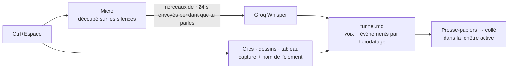

<div align="center">


# Unitunel

**Parle. Pointe. Dessine. L'IA reçoit tout.**

Une dictée vocale de bureau qui garde aussi ce que tu *montres* : chaque clic, chaque trait, chaque écran,<br>
tissés dans un seul prompt horodaté que tu colles à ton agent.

[](https://github.com/martinbon39/Unitunel/actions/workflows/build.yml)
[](https://github.com/martinbon39/Unitunel/releases)

[](LICENSE)

[Télécharger](#télécharger) · [Fonctionnement](#fonctionnement) · [Confidentialité](#confidentialité) · [Build](#compiler) · [🇬🇧 English](README.md)

</div>

---

Expliquer un bug d'interface ou une idée de design à un agent IA par écrit, c'est lent. On finit par écrire
« le deuxième bouton, en haut à droite, dans le panneau des réglages… » et par coller cinq captures dans le désordre.

Avec Unitunel, tu appuies sur `Ctrl+Espace` et **tu montres**. Une aura lumineuse entoure l'écran, et tu
parles aussi longtemps que tu veux en utilisant ton ordinateur normalement. Chaque clic est capturé et situé.
Tu peux dessiner sur l'écran ou ouvrir un tableau blanc. Quand tu arrêtes, un **tunnel** est collé là où tu
étais : ta voix transcrite mot à mot et horodatée, entrecoupée de chaque clic (application, fenêtre, élément
exact sous le pointeur) et des captures annotées.

- **Rapide.** L'audio est découpé sur les silences pendant que tu parles et part par morceaux : un tunnel de 20 minutes est prêt quelques secondes après l'arrêt.
- **Précis.** Chaque clic donne une capture complète avec le point marqué, un zoom autour, et (sous Windows) le nom de l'élément visé.
- **Invisible.** Aucune fenêtre, seulement un overlay et une icône de barre système. L'overlay est exclu de ses propres captures.
- **Léger.** Environ 1 500 lignes de Rust et de HTML sur Tauri 2. Natif, pas Electron.

## Ce que reçoit ton agent

```markdown
# Tunnel du 18/11/2026 14:02 · 1 min 12 s

> [00:00] ÉCRAN AU DÉPART — …/2026-11-18_14-02-11/00-debut.jpg

[00:01] Alors sur cette page de réglages, le bouton enregistrer ne fait rien.

> [00:04] CLIC 1 · Firefox — « Réglages · MonApp » · sur : bouton "Enregistrer", formulaire "Profil" — capture …/01-clic.jpg (zoom …/01-clic-zoom.jpg)

[00:05] Je clique, pas de toast, et quand je recharge, le nom est revenu à l'ancien.

> [00:19] DESSIN 1 sur l'écran — …/02-dessin.jpg

[00:20] Et ce bloc, je le verrais plutôt ici, aligné avec l'avatar.
```

Chaque tunnel est aussi rangé dans `Documents/Unitunel/<date_heure>/` : `tunnel.md`, les captures `.jpg`,
le tableau `.png` et l'audio `voix.wav`.

## Fonctionnement



| Geste | Effet |
|---|---|
| `Ctrl+Espace` (macOS : `⌥ Espace`) | démarre ; le rappuyer envoie |
| maintenir `Ctrl+Espace` | push-to-talk : relâcher envoie |
| clic n'importe où | capture de l'écran, point du clic marqué, élément pointé nommé |
| bord droit de l'écran | rail : `✎` dessiner · `▦` tableau blanc · `↵` envoyer · `×` annuler |
| menu de l'icône › Raccourci | changer la combinaison : appuie sur celle que tu veux, puis Enregistrer |
| `Échap` | quitte le dessin ou le tableau (hors dessin, Échap reste aux autres apps) |
| clic droit en dessin | revient au direct |

## Télécharger

Les builds Windows (installeur `.exe` + portable) et macOS (`.dmg` universel) sont sur la page
**[Releases](https://github.com/martinbon39/Unitunel/releases)**. Chaque push sur `main` est aussi construit
par GitHub Actions (onglet Actions › dernier run › artefacts).

Les binaires **ne sont pas encore signés**, ton système t'avertira au premier lancement :

- **Windows :** SmartScreen affiche « Windows a protégé votre ordinateur ». Clique **Informations complémentaires › Exécuter quand même**.
- **macOS :** ouvre l'app une fois, puis **Réglages Système › Confidentialité et sécurité › Ouvrir quand même**.
  Si macOS dit que l'app est endommagée : `xattr -cr /Applications/Unitunel.app`.
  Autorise ensuite Unitunel dans **Micro**, **Enregistrement de l'écran** et **Accessibilité** (pour les clics et le collage).

## Réglages

Il te faut une [clé API Groq](https://console.groq.com/keys) gratuite. Au premier lancement, Unitunel écrit
`config.json` (menu de l'icône › Réglages) :

```json
{
  "groq_api_key": "gsk_…",
  "language": "fr",
  "model": "whisper-large-v3",
  "vocabulary": ["Unitunel", "Claude Code"],
  "auto_paste": true,
  "output_dir": null
}
```

| Clé | Rôle |
|---|---|
| `groq_api_key` | ta clé Groq. La variable d'environnement `GROQ_API_KEY` sert aussi |
| `language` | langue parlée (code ISO), transmise à Whisper |
| `model` | `whisper-large-v3` pour la précision, `whisper-large-v3-turbo` pour la vitesse |
| `vocabulary` | noms propres à bien orthographier |
| `auto_paste` | coller le tunnel dans la fenêtre active, ou seulement le copier |
| `output_dir` | où ranger les tunnels (par défaut `Documents/Unitunel`) |
| `shortcut` | le raccourci (`Control+Space`, `Alt+Space`…), plus simple à changer depuis le menu de l'icône |

Emplacement : `%APPDATA%\unitunel\config.json` sur Windows, `~/Library/Application Support/unitunel/config.json` sur macOS.

## Confidentialité

Unitunel n'a ni serveur, ni compte, ni télémétrie. Le seul appel réseau est la transcription :

| Donnée | Destination |
|---|---|
| Ta voix (morceaux audio) | envoyée à l'API Whisper de **Groq** avec ta clé, seulement pendant un tunnel. Voir la [politique de Groq](https://groq.com/privacy-policy/) |
| Captures, dessins, tableau, noms d'apps et de fenêtres | **jamais envoyés**. Ils restent sur ton disque jusqu'à ce que tu colles le tunnel quelque part |
| Ta clé API | stockée en clair dans `config.json`, sur ta machine |

Le tunnel que tu colles contient les titres de fenêtres et des captures de tout ce qui était à l'écran.
Il n'y a pas encore de mode de transcription 100 % local.

## Limites connues

- Le nom de l'élément sous le pointeur vient de l'UI Automation de Windows. Sur macOS, un clic donne l'app,
  la fenêtre et les captures, mais pas encore le nom de l'élément.
- Pas de build Linux.

## Compiler

Il faut [Rust](https://rustup.rs) (stable) et Node.js 18+ pour la CLI Tauri.

```sh
cd src-tauri && cargo check      # vérification rapide
npx @tauri-apps/cli@2 dev        # lancer en local
npx @tauri-apps/cli@2 build      # Windows : .exe NSIS
npx @tauri-apps/cli@2 build --target universal-apple-darwin   # macOS : .dmg
```

Un tag `v*` publie une release GitHub avec les deux builds. Le détail des fichiers source est dans le [README anglais](README.md#build-from-source).

## Contribuer

Issues et pull requests bienvenues. De bonnes premières contributions : un modèle de tunnel en anglais, les
noms d'éléments sur macOS (API Accessibilité), un backend Whisper local, le support Linux. Pour un bug, indique
ton OS, sa version et, si possible, le `tunnel.md` concerné.

## Licence

[MIT](LICENSE) © 2026 Martin Bonan. La police Geist Mono embarquée est sous [SIL Open Font License](ui/fonts/LICENSE-Geist.txt).
