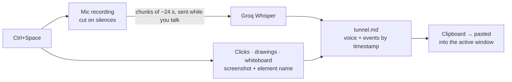

<div align="center">


# Unitunel

**Talk. Point. Draw. Your AI gets all of it.**

Voice dictation for the desktop that also records what you *show*: every click, every scribble, every screen,<br>
woven into one timestamped prompt you paste into your agent.

[](https://github.com/martinbon39/Unitunel/actions/workflows/build.yml)
[](https://github.com/martinbon39/Unitunel/releases)

[](LICENSE)

[Download](#download) · [How it works](#how-it-works) · [Privacy](#privacy) · [Build](#build-from-source) · [🇫🇷 Français](README.fr.md)

</div>

---

Explaining a UI bug or a design idea to an AI agent in text is slow. You end up writing "the second button,
top right, in the settings panel…" and pasting five screenshots out of order.

With Unitunel you press `Ctrl+Space` and **just show it**. A glowing aura appears around your screen and you
talk for as long as you want while you use your computer normally. Each click is captured and located. You can
draw on the screen or open a whiteboard. When you stop, a **tunnel** is pasted where you were: your voice
transcribed word for word with timestamps, interleaved with each click (app, window, exact element under the
pointer) and the annotated screenshots.

- **Fast.** Audio is cut on silences while you talk and sent in chunks, so a 20-minute tunnel is ready a few seconds after you stop.
- **Precise.** Each click gets a full screenshot with the click marked, a zoomed crop around it, and (on Windows) the name of the UI element you hit.
- **Invisible.** No window, only an overlay and a tray icon. The overlay is excluded from its own screenshots.
- **Small.** About 1,500 lines of Rust and HTML on Tauri 2. Native, not Electron.

## What your agent receives

```markdown
# Tunnel du 18/11/2026 14:02 · 1 min 12 s

> [00:00] ÉCRAN AU DÉPART — …/2026-11-18_14-02-11/00-debut.jpg

[00:01] So on this settings page, the save button does nothing.

> [00:04] CLIC 1 · Firefox — « Settings · MyApp » · sur : button "Save", form "Profile" — capture …/01-clic.jpg (zoom …/01-clic-zoom.jpg)

[00:05] I click it, no toast, and when I reload, the name is back to the old one.

> [00:19] DESSIN 1 sur l'écran — …/02-dessin.jpg

[00:20] And this block, I'd like it here instead, aligned with the avatar.
```

Every tunnel is also saved in `Documents/Unitunel/<date_time>/`: `tunnel.md`, the `.jpg` screenshots, the whiteboard
`.png` and the audio `voix.wav`. The tunnel template is in French for now (see [Contributing](#contributing)).

## How it works



| Gesture | Effect |
|---|---|
| `Ctrl+Space` (macOS: `⌥ Space`) | start. Press again to send |
| hold `Ctrl+Space` | push-to-talk: release to send |
| click anywhere | screenshot, click point marked, element under the pointer named |
| right edge of the screen | rail: `✎` draw · `▦` whiteboard · `↵` send · `×` cancel |
| tray icon menu › Réglages | shortcut, Groq key, language, model, vocabulary, paste, folder |
| `Esc` | leave drawing or the whiteboard (outside drawing, Esc goes to your other apps) |
| right-click while drawing | back to live mode |

## Download

Builds for Windows (`.exe` installer + portable) and macOS (universal `.dmg`) are on the
**[Releases](https://github.com/martinbon39/Unitunel/releases)** page. Every push to `main` is also built by
GitHub Actions (Actions tab › latest run › artifacts).

The binaries are **not signed** yet, so your OS will warn you on first launch:

- **Windows:** SmartScreen says "Windows protected your PC". Click **More info › Run anyway**.
- **macOS:** open the app once, then go to **System Settings › Privacy & Security** and click **Open Anyway**.
  If macOS says the app is damaged, run `xattr -cr /Applications/Unitunel.app`.
  Then allow Unitunel under **Microphone**, **Screen Recording** and **Accessibility** (for clicks and pasting).

## Setup

You need a free [Groq API key](https://console.groq.com/keys). On first launch Unitunel writes a `config.json`
that you can edit in the Réglages window (tray icon › *Réglages*) or by hand:

```json
{
  "groq_api_key": "gsk_…",
  "language": "fr",
  "model": "whisper-large-v3",
  "vocabulary": ["Unitunel", "Claude Code"],
  "auto_paste": true,
  "output_dir": null
}
```

| Key | Meaning |
|---|---|
| `groq_api_key` | your Groq key. The `GROQ_API_KEY` environment variable works too |
| `language` | spoken language (ISO code), passed to Whisper |
| `model` | `whisper-large-v3` for accuracy, `whisper-large-v3-turbo` for speed |
| `vocabulary` | proper nouns Whisper should spell right |
| `auto_paste` | paste the tunnel into the active window, or only copy it |
| `output_dir` | where tunnels are saved (default `Documents/Unitunel`) |
| `remote` | send tunnels over SSH to a server: `enabled`, `target` (`user@host`), `dir` (absolute path), `keep_local` |
| `shortcuts` | up to 3 shortcuts (`["Control+Space", "PageDown"]`), easier to change in Réglages |

Location: `%APPDATA%\unitunel\config.json` on Windows, `~/Library/Application Support/unitunel/config.json` on macOS.

## Privacy

Unitunel has no server, no account and no telemetry. The only network call it makes is the transcription:

| Data | Where it goes |
|---|---|
| Your voice (audio chunks) | sent to **Groq**'s Whisper API with your key, only while a tunnel is recording. See [Groq's privacy policy](https://groq.com/privacy-policy/) |
| Screenshots, drawings, whiteboard, app and window names | **never sent**. They stay on your disk until you paste the tunnel somewhere |
| Your API key | stored in plain text in `config.json` on your machine |

Remember that the tunnel you paste includes window titles and screenshots of whatever was on screen.
A fully local transcription mode is not available yet.

## Known limitations

- The name of the element under the pointer comes from Windows UI Automation. On macOS, clicks get the app,
  the window and the screenshots, but no element name yet.
- The tunnel text is in French.
- No Linux build.

## Build from source

You need [Rust](https://rustup.rs) (stable) and Node.js 18+ for the Tauri CLI.

```sh
cd src-tauri && cargo check      # quick check
npx @tauri-apps/cli@2 dev        # run locally
npx @tauri-apps/cli@2 build      # Windows: NSIS .exe
npx @tauri-apps/cli@2 build --target universal-apple-darwin   # macOS: .dmg
```

Pushing a `v*` tag publishes a GitHub release with both builds.

```
src-tauri/src/
  lib.rs         tray, shortcuts, overlay, input hooks
  session.rs     one tunnel: events, screenshots, rendering tunnel.md
  audio.rs       mic capture, resampling, silence-based chunking
  transcribe.rs  Groq Whisper calls
  capture.rs     screenshots, click markers, strokes, crops
  platform.rs    foreground window, UI Automation element names, paste
  config.rs      config.json
ui/index.html    the overlay: aura, status pill, rail, drawing, whiteboard
```

## Contributing

Issues and pull requests are welcome. Good first contributions: an English tunnel template, element names on
macOS (Accessibility API), a local Whisper backend, Linux support. When you report a bug, include your OS and
version and, if you can, the `tunnel.md` that went wrong.

## License

[MIT](LICENSE) © 2026 Martin Bonan. The bundled Geist Mono font is under the [SIL Open Font License](ui/fonts/LICENSE-Geist.txt).

Built with [Tauri](https://tauri.app), [cpal](https://github.com/RustAudio/cpal), [xcap](https://github.com/nashaofu/xcap)
and [enigo](https://github.com/enigo-rs/enigo). Transcription by [Groq](https://groq.com) running OpenAI's Whisper.
